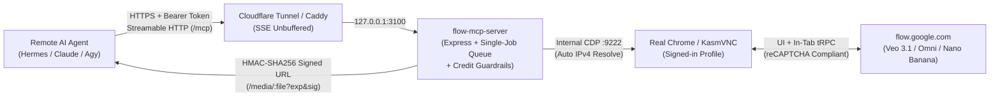

# google-flow-mcp-http

Plug-and-play, remote-ready **Model Context Protocol (MCP)** server for automating [Google Flow](https://flow.google.com/) (**Veo 3.1 Quality / Fast / Lite**, **Omni Flash**, **Nano Banana Pro / 2**, **Imagen 4**, and **ffmpeg** scene assembly) through a real Chrome session (**Chrome DevTools Protocol / CDP**) exposed over **MCP Streamable HTTP** (`POST`, `GET`, `DELETE /mcp`).

Designed end-to-end so remote AI agents (Hermes Agent, Claude Code, Antigravity, Cursor, or multi-agent orchestrators on another VPS) can produce visual assets using your Google Flow subscription credits safely.

## End-to-End Architecture



## Plug-and-Play Quickstart (3 Minutes)

### Option A: Headless Linux Homelab / VPS (Docker + KasmVNC + Cloudflare Tunnel)

```bash
git clone https://github.com/ridloabelian/google-flow-mcp-http.git
cd google-flow-mcp-http

# 1. Generate .env (256-bit random secrets), proxy templates, & generated-configs/mcp-client.json
./setup.sh --domain flow-mcp.yourdomain.com --tunnel-token "<CLOUDFLARE_TUNNEL_TOKEN>"

# 2. Start Chromium KasmVNC + MCP Server + Cloudflare Tunnel
make up-tunnel

# 3. Sign into Google Flow once via SSH port-forward to the KasmVNC web GUI
#    Run on your laptop: ssh -L 3001:127.0.0.1:3001 user@server-ip
#    Open https://localhost:3001 in your browser, sign in at flow.google.com, then close the SSH tunnel.

# 4. (Optional) Provision response_body_buffering=none on Cloudflare via one API command
CF_API_TOKEN="..." CF_ZONE_ID="..." PUBLIC_BASE_URL="https://flow-mcp.yourdomain.com" make cf-provision

# 5. Verify end-to-end JSON-RPC Streamable HTTP connectivity
make test
```

### Option B: Local Bare-Metal (macOS / Linux Desktop)

```bash
git clone https://github.com/ridloabelian/google-flow-mcp-http.git
cd google-flow-mcp-http

./setup.sh --non-interactive
make install
make chrome   # Sign into Google in the Chrome window that opens (one-time only)
make start    # Endpoint listens at http://127.0.0.1:3100/mcp
```

## Connecting Remote Agents & Installing the Skill

Once `./setup.sh` finishes, a ready-to-paste client configuration with your generated Bearer token is saved at `generated-configs/mcp-client.json`:

```json
{
  "mcpServers": {
    "google-flow": {
      "type": "http",
      "url": "https://flow-mcp.yourdomain.com/mcp",
      "headers": {
        "Authorization": "Bearer <AUTO_GENERATED_256_BIT_TOKEN>"
      }
    }
  }
}
```

Install `SKILL.md` into your local agent runtimes (`~/.hermes/skills`, `~/.claude/skills`, and `.agent/skills`):

```bash
make install-skill
```

## `Makefile` Command Reference

| Command | Description |
| :--- | :--- |
| `make setup` | Run `./setup.sh` to generate `.env`, 256-bit secrets, and client/proxy configs |
| `make up` | Start the Docker stack (`chrome-flow` KasmVNC + `flow-mcp-server`) |
| `make up-tunnel` | Start the Docker stack with the `cloudflared` sidecar container |
| `make down` | Stop all running Docker containers |
| `make logs` | Tail live logs from `flow-mcp-server` |
| `make doctor` | Probe CDP targets and automatically close crashed Chrome tabs (`Aw, Snap!`) |
| `make test` | Run end-to-end JSON-RPC smoke tests (`initialize` -> `tools/list` -> `flow_status`) |
| `make install-skill` | Copy `skills/google-flow-mcp/SKILL.md` into agent skill directories |
| `make cf-provision` | Apply `response_body_buffering: "none"` on `/mcp*` via Cloudflare Zone API |

## 10 Exposed MCP Tools

| Tool | Description |
| :--- | :--- |
| `flow_status` | Check CDP reachability, Google login state, UI credit balance, and queue metrics |
| `flow_doctor` | Inspect CDP targets and clean up hung/crashed tabs (`closeHungTabs: true`) |
| `flow_list_models` | List Veo 3.1 / Omni Flash / Nano Banana models from in-tab tRPC & catalog |
| `flow_list_history` | List recent server jobs with signed download URLs and active DOM media tiles |
| `flow_create_project` | Open and create a new project workspace in Google Flow |
| `flow_generate_image` | Generate images (`Nano Banana 2`, `Nano Banana Pro`, `Imagen 4`) with `dryRun` support |
| `flow_generate_video` | Generate videos (`Omni Flash`, `Veo 3.1 Lite/Fast/Quality`) + SSE progress + signed MP4 URL |
| `flow_job_status` | Fetch job state from disk or recover timed-out connections via `resumeJobId` |
| `flow_export_scene` | Concatenate multiple MP4 clips into a normalized 24 fps H.264/AAC MP4 via `ffmpeg` |
| `flow_discover_ui` | Inspect live interactive DOM elements if the Google Flow web UI changes |

## Further Documentation

- [System Architecture & CDP + Streamable HTTP Security](docs/ARCHITECTURE.md)
- [Cloudflare Tunnel, Zero Trust Access, Caddy, & Nginx Guide](docs/CLOUDFLARE_TUNNEL.md)
- [Agent Workflow Skill (`SKILL.md`)](skills/google-flow-mcp/SKILL.md)

## License

MIT © Ridlo Abelian
