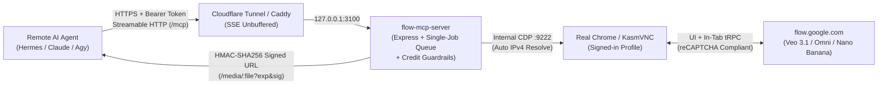

# google-flow-mcp-http

Plug-and-play, remote-ready **Model Context Protocol (MCP)** server untuk mengotomasi [Google Flow](https://flow.google.com/) (**Veo 3.1 Quality / Fast / Lite**, **Omni Flash**, **Nano Banana Pro / 2**, **Imagen 4**, dan penggabungan klip **ffmpeg**) melalui sesi Chrome asli (**Chrome DevTools Protocol / CDP**) yang diekspos lewat **MCP Streamable HTTP** (`POST`, `GET`, `DELETE /mcp`).

Dirancang dari hulu ke hilir supaya agen AI jarak jauh (Hermes Agent, Claude Code, Antigravity, Cursor, maupun orchestrator multi-agent di VPS lain) bisa memproduksi aset visual menggunakan kuota kredit langganan Google Flow kamu secara aman.

## Arsitektur End-to-End



## Quickstart Plug-and-Play (3 Menit)

### Jalur A: Homelab / VPS Linux Headless (Docker + KasmVNC + Cloudflare Tunnel)

```bash
git clone https://github.com/ridloabelian/google-flow-mcp-http.git
cd google-flow-mcp-http

# 1. Generate .env (token acak 256-bit), template proxy, & generated-configs/mcp-client.json
./setup.sh --domain flow-mcp.domainkamu.id --tunnel-token "<CLOUDFLARE_TUNNEL_TOKEN>"

# 2. Nyalakan Chromium KasmVNC + MCP Server + Cloudflare Tunnel
make up-tunnel

# 3. Login akun Google sekali saja lewat SSH port-forward ke GUI web KasmVNC
#    Jalankan di laptop kamu: ssh -L 3001:127.0.0.1:3001 user@ip-server
#    Buka https://localhost:3001 di browser, login ke flow.google.com, lalu tutup tunnel SSH.

# 4. (Opsional) Set aturan response_body_buffering=none di Cloudflare via API satu perintah
CF_API_TOKEN="..." CF_ZONE_ID="..." PUBLIC_BASE_URL="https://flow-mcp.domainkamu.id" make cf-provision

# 5. Verifikasi koneksi JSON-RPC Streamable HTTP end-to-end
make test
```

### Jalur B: Bare-Metal Lokal (macOS / Linux Desktop)

```bash
git clone https://github.com/ridloabelian/google-flow-mcp-http.git
cd google-flow-mcp-http

./setup.sh --non-interactive
make install
make chrome   # Login ke akun Google pada jendela Chrome yang terbuka (cukup sekali)
make start    # Endpoint aktif di http://127.0.0.1:3100/mcp
```

## Menghubungkan Remote Agent & Skill

Setelah `./setup.sh` selesai dijalankan, file konfigurasi klien dengan token asli langsung tersedia di `generated-configs/mcp-client.json`:

```json
{
  "mcpServers": {
    "google-flow": {
      "type": "http",
      "url": "https://flow-mcp.domainkamu.id/mcp",
      "headers": {
        "Authorization": "Bearer <AUTO_GENERATED_256_BIT_TOKEN>"
      }
    }
  }
}
```

Untuk memasang `SKILL.md` ke runtime agen lokal secara otomatis (`~/.hermes/skills`, `~/.claude/skills`, dan `.agent/skills`):

```bash
make install-skill
```

## Daftar Perintah `Makefile`

| Perintah | Fungsi |
| :--- | :--- |
| `make setup` | Menjalankan `./setup.sh` untuk membuat `.env`, secret 256-bit, dan config klien |
| `make up` | Menjalankan stack Docker (`chrome-flow` KasmVNC + `flow-mcp-server`) |
| `make up-tunnel` | Menjalankan stack Docker lengkap dengan sidecar `cloudflared` |
| `make down` | Menghentikan seluruh container Docker |
| `make logs` | Menampilkan log live dari container `flow-mcp-server` |
| `make doctor` | Mengecek endpoint CDP & menutup otomatis tab Chrome yang crash (`Aw, Snap!`) |
| `make test` | Menjalankan *smoke test* JSON-RPC (`initialize` -> `tools/list` -> `flow_status`) |
| `make install-skill` | Menyalin `skills/google-flow-mcp/SKILL.md` ke direktori skill agen |
| `make cf-provision` | Memasang aturan `response_body_buffering: "none"` otomatis ke Cloudflare Zone API |

## Katalog 10 MCP Tools

| Tool | Deskripsi |
| :--- | :--- |
| `flow_status` | Cek keterjangkauan CDP, status login akun Google, saldo kredit di UI, dan antrean aktif |
| `flow_doctor` | Cek kesehatan target tab CDP dan bersihkan tab crash (`closeHungTabs: true`) |
| `flow_list_models` | Ambil daftar model Veo 3.1 / Omni Flash / Nano Banana dari in-tab tRPC & katalog |
| `flow_list_history` | Lihat riwayat job server terbaru beserta signed download URL dan tile media DOM |
| `flow_create_project` | Buat workspace project baru di Google Flow |
| `flow_generate_image` | Generate gambar (`Nano Banana 2`, `Nano Banana Pro`, `Imagen 4`) + opsi `dryRun` |
| `flow_generate_video` | Generate klip video (`Omni Flash`, `Veo 3.1 Lite/Fast/Quality`) + SSE progress + signed MP4 URL |
| `flow_job_status` | Ambil status job dari state disk atau pulihkan koneksi yang terputus |
| `flow_export_scene` | Gabungkan beberapa klip MP4 menjadi satu video 24 fps H.264/AAC via `ffmpeg` |
| `flow_discover_ui` | Inspeksi live elemen interaktif DOM bila antarmuka web Google Flow diperbarui |

## Dokumentasi Lanjutan

- [Arsitektur Sistem & Keamanan CDP + Streamable HTTP](docs/ARCHITECTURE.md)
- [Panduan Cloudflare Tunnel, Zero Trust Access, Caddy, & Nginx](docs/CLOUDFLARE_TUNNEL.md)
- [Agent Workflow Skill (`SKILL.md`)](skills/google-flow-mcp/SKILL.md)

## Lisensi

MIT © Ridlo Abelian
